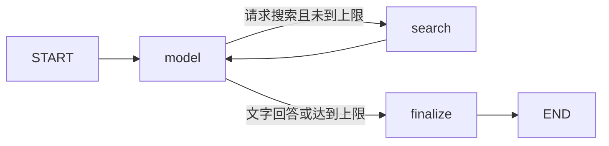

# PezMax Agent

独立的 Python + LangGraph 智能体模块。负责理解资料需求、调用模型、检索 Go 目录接口、控制工具次数和生成回答。Electron 使用 stdio 启动本地子进程，Vue/Ant Design 展示会话、阅读结果与真实资源卡片。

0.2 新增可选 **FastAPI 服务、官方 MCP SDK 2.x 只读服务和持久化文档 RAG**。支持显式导入 PDF/EPUB/文本、本地中文 BM25、BYOK 向量与 RRF 融合，以及跨文档引用核验问答。详见[可行性与设计](docs/service-design.md)、[安装与接口使用](docs/service.md)。HTTP/MCP 入口使用 `service` extra。

0.3 将共享检索能力接入桌面“我的知识库”：显式本机导入、文档管理、关键词/混合检索、引用问答和原文查看。继续通过 stdio 调用，无需启动 API 服务；对话与 Embedding 采用独立 BYOK 设置。说明见[桌面知识库](docs/desktop-knowledge.md)。

[0.2服务与检索验证记录](docs/service-verification.md)与[0.3桌面知识库验证记录](docs/desktop-knowledge-verification.md)包含检查范围、合成集指标与未验证边界。

## 开发

需要 Python 3.11 或以上。快捷方式（PowerShell，本目录）：

```powershell
.\start.ps1            # 自检：虚拟环境、依赖、LangGraph 状态图
.\start.ps1 -Install   # 初始化 .venv 与 .venv-service 及全部依赖
.\start.ps1 -Serve     # 启动 API 服务 http://127.0.0.1:9044/docs（首次自动生成 data/service-token.txt）
.\start.ps1 -Desktop   # 启动桌面端开发模式，由 Electron 经 stdio 拉起智能体
```

`-Serve` 可加 `-ProviderUrl https://模型服务/v1` 加入模型白名单、`-CatalogUrl http://127.0.0.1:9033` 配置目录接口、`-Port 9045` 换端口。脚本不写死密钥：访问令牌落在 git 忽略的 `data/service-token.txt`，模型 Key 仍由调用方每次请求提供。

等价的手工步骤：

```powershell
python -m venv .venv
.venv\Scripts\python -m pip install -r requirements.lock -e ".[build]"
.venv\Scripts\python -m unittest discover -s tests -v
.venv\Scripts\python -m pezmax_agent --check
```

macOS / Linux 将 `.venv\Scripts\python` 换为 `.venv/bin/python`。桌面端开发启动时自动寻找相邻目录的虚拟环境；也可通过 `PEZMAX_AGENT_PYTHON` 指定已安装此模块的 Python 解释器。

## 图与模块边界



`graph.py` 使用真正的 `StateGraph`、状态更新、条件边和 `ainvoke`；每轮最多5次模型调用、8次检索，最后一次强制总结。`provider.py` 是兼容 Chat Completions 的模型适配器；`tools.py` 定义唯一只读工具及参数校验；`catalog.py` 负责平台鉴权、分页、筛选、上架状态复核，以及模型元数据和本地预览对象的分离。

`contracts.py` 定义历史、配置和脱敏规则；`cli.py` 负责进程协议，`application.py` 为 stdio 与 HTTP 复用原任务。`desktop_knowledge.py` 处理仅限可信桌面入口的本机导入与知识库动作，复用服务检索核心。Python 不保存 API Key 和平台令牌，不将它们放入图状态或托管追踪。桌面无需单独部署服务器或开放本机端口；用户显式导入的知识库正文和可选向量保存在本机 SQLite。Electron 可按用户选择使用 OS 加密保存模型密钥。

`upload.py` 是独立的上传建议状态图：`START → suggest → validate → END`，每次只调用一次模型。输入仅为上传种类、是否为文件夹和文件名列表，不访问目录、正文或文件系统，也不具备上传/重命名工具。输出限制为当前表单支持的字段，逐项核对枚举、长度、年份与文件名原文依据。无法确定的字段省略；文件夹不建议标题，只建议每个文件名都支持的共同分类，最多20个文件；跨学年或混合年份不建议年份。

`reading.py` 支持 PDF / EPUB 的问答、摘要和提纲。图为 `retrieve → answer → validate`；结构或引用校验失败且没有有效回答时，通过条件边进入 `repair → validate`，最多纠正一次、总计最多2次模型调用。显式空回答和已有有效回答的情况不重试；传输/鉴权错误直接报错。纠正仅使用相同任务和相同片段，不重放无效回答，不扩大文档读取范围。

桌面端明确选择页码或分节后本地提取文字。问答按词语匹配选择最多6段、每段1800字符；摘要/提纲在所选内容中均匀抽取最多6段，披露部分覆盖。`reading_schema.py` 使用 Pydantic v2 严格模型生成 JSON Schema 并核验输出，拒绝隐式页码类型转换和额外字段。保持服务商兼容性，不依赖服务商的原生 `json_schema` 解码参数。每条回答至少1条、最多3条原文引用，任意引用不符则丢弃整条回答；PDF 使用物理页码，EPUB 使用书脊分节序号。没有工具、目录客户端、文件路径或下载地址；不是全文向量检索，也不能保证回答的语义推论正确。

`telemetry.py` 为状态图记录节点耗时、执行结果和调用次数。白名单只允许固定节点名、布尔结果与非负数字，既不采集图状态，也不落盘或上传。完整数值诊断通过本机 stdio 返回；阅读界面只保留总耗时和模型调用数，桌面知识库仅投影已核验的文档、检索与回答。取消/异常透传，失败记录不包含原始异常内容；进程错误仍沿用固定错误消息。

## 进程协议 v1

每个子进程只处理一条请求，完成后退出。输入、输出均为 UTF-8 NDJSON。输入上限512 KiB，外层总时限180秒，模型请求60秒，目录请求10秒；取消时由 Electron 结束当前子进程。

输入对象：`{version:1, requestId, provider:{baseUrl,model,apiKey}, catalog:{baseUrl,token}, history:[], question}`。连接测试使用 `test:true`，不需要 `catalog`。密钥仅由 Electron 写入 stdin，不能放入命令行参数或环境变量。

上传建议使用同一 v1 协议的可选任务：`{version:1, requestId, provider, task:"upload", upload:{kind:"exam"|"ebook", folder:false, names:["示例大学2026高等数学期末.pdf"]}}`。不需要也不会使用平台令牌、检索历史或表单现值。结果保留 `content/messages/resources/reports`，额外返回 `suggestions:[{field,value,evidence}]`；其余三个数组为空。`fileType`/`ebookType` 使用数字枚举，其余建议值为字符串。调用方必须在用户逐项确认后应用，不能直接提交上传。

阅读使用 `{version:1, requestId, provider, task:"reading", reading:{question,pages:[{page:2,text:"所选页文字"}]}}`。PDF 默认格式，`mode` 默认为 `qa`，兼容原有请求。`mode:"summary"|"outline"` 使用固定任务，忽略调用方 question。EPUB 使用 `reading:{format:"epub",mode:"summary",chapters:[{chapter:2,text:"所选分节文字"}]}`，不包含 `pages`。

PDF 每轮1–10页，每页最多20000字符；EPUB 每轮1–5节，每节最多40000字符；位置均为1–10000整数、总文字不超过80000字符，问答问题最多2000字符。输出 `answers:[{text,citations:[{page,quote}]}]` / `{chapter,quote}`、`contextPages` / `contextChapters`、`partial` 和 `diagnostics`，历史与资源数组为空。片段不足时返回空回答和固定提示；不支持 OCR。

知识库是同一 v1 协议的桌面专用 `task:"knowledge"`。`knowledge.action` 限于 `list/import/delete/search/ask/read`；可信主进程提供 `storage:{path,owner}`，导入另提供系统选择器选定的 `localDocument`。`ask` 才需 `provider`，显式混合模式才需独立的 `embedding`。结果额外放在 `knowledge` 字段；这套文件路径契约不暴露给 HTTP 或 MCP。完整限制见[桌面知识库](docs/desktop-knowledge.md)。

输出对象均含 `version`、`requestId` 和 `type`：

- `progress`：`data` 含状态，或真实资源与本次检索报告。
- `result`：`data` 含 `messages`（供下轮使用的有界历史）、`content`、`resources`、`reports`。
- `error`：仅返回应用生成的 `error` 和 `code`，不返回服务商原始报错或堆栈。

找资料时模型只收到问题、近期对话和目录元数据；上传建议只收到文件名；阅读问答只收到问题和所选页的相关文字片段。平台令牌仅用于固定的 `/datum/file/list`、`/datum/ebook/list`、`/datum/bookmark/list`；文件URL与预览对象只返回桌面界面。智能体没有下载正文、任意HTTP或写操作工具。

## 发布

在目标操作系统和架构上执行：

```powershell
.venv\Scripts\python scripts/build.py
```

PyInstaller 生成 `dist/pezmax-agent/`（包含解释器、依赖与平台清单），自动运行离线启动自检。Electron 打包将整个目录复制到 `resources/agent/`，普通用户无需安装 Python。不同系统/架构应分别构建，不能混用二进制。

LangGraph 的状态、节点与条件边接口参见[官方 Graph API 文档](https://docs.langchain.com/oss/python/langgraph/graph-api)。

## 离线评测与项目展示

```powershell
.venv\Scripts\python -m pezmax_agent.evaluation --output evals/results/local.json
```

在桌面端也可执行 `npm run agent:eval -- --output evals/results/local.json`（输出路径相对本模块）。固定合成数据集 `evals/reading-cases.json` 的10种行为在 PDF/EPUB × 问答/摘要/提纲下组成60个案例，运行真实 LangGraph 图并注入可复现的脚本模型响应，无需密钥或联网。比较未经校验首答、仅校验、带一次纠正三种处理方式，独立检查引文、类型和输出字段，记录行为通过数、无效引用释放数、恢复数与调用预算。

这只衡量编排与引用契约，不衡量真实模型语义准确率、线上延迟、用户留存或服务商成本。运行结果和范围应一起呈现。详见 [Agent 工程架构与取舍](../PezMax-Desktop/docs/agent-engineering.md) 和 [求职展示素材](../PezMax-Desktop/docs/agent-portfolio.md)。
