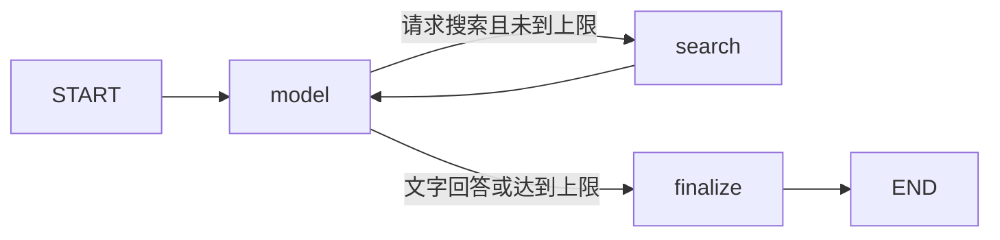

# PezMax Agent

独立的 Python + LangGraph 智能体模块。负责理解资料需求、调用模型、检索 Go 目录接口、控制工具次数和生成回答。Electron 使用 stdio 启动本地子进程，Vue/Ant Design 只展示会话与真实资源卡片。

## 开发

需要 Python 3.11 或以上。在本目录执行：

```powershell
python -m venv .venv
.venv\Scripts\python -m pip install -r requirements.lock -e ".[build]"
.venv\Scripts\python -m unittest discover -s tests -v
.venv\Scripts\python -m pezmax_agent --check
```

macOS / Linux 将 `.venv\Scripts\python` 换为 `.venv/bin/python`。桌面端开发启动时自动寻找相邻目录的虚拟环境；也可通过 `PEZMAX_AGENT_PYTHON` 指定已安装此模块的 Python 解释器。

## 图与模块边界



`graph.py` 使用真正的 `StateGraph`、状态更新、条件边和 `ainvoke`；每轮最多5次模型调用、8次检索，最后一次强制总结。`provider.py` 是兼容 Chat Completions 的模型适配器；`tools.py` 定义唯一只读工具及参数校验；`catalog.py` 负责平台鉴权、分页、筛选、上架状态复核，以及模型元数据和本地预览对象的分离。

`contracts.py` 定义历史、配置和脱敏规则；`cli.py` 负责进程协议。API Key 和平台令牌只在进程内存中使用，不放入图状态、不落盘、不接入托管追踪。模块无需单独部署服务器、数据库或开放本机端口。

## 进程协议 v1

每个子进程只处理一条请求，完成后退出。输入、输出均为 UTF-8 NDJSON。输入上限512 KiB，外层总时限180秒，模型请求60秒，目录请求10秒；取消时由 Electron 结束当前子进程。

输入对象：`{version:1, requestId, provider:{baseUrl,model,apiKey}, catalog:{baseUrl,token}, history:[], question}`。连接测试使用 `test:true`，不需要 `catalog`。密钥仅由 Electron 写入 stdin，不能放入命令行参数或环境变量。

输出对象均含 `version`、`requestId` 和 `type`：

- `progress`：`data` 含状态，或真实资源与本次检索报告。
- `result`：`data` 含 `messages`（供下轮使用的有界历史）、`content`、`resources`、`reports`。
- `error`：仅返回应用生成的 `error` 和 `code`，不返回服务商原始报错或堆栈。

模型只收到问题、近期对话和目录元数据。平台令牌仅用于固定的 `/datum/file/list`、`/datum/ebook/list`、`/datum/bookmark/list`；文件URL与预览对象只返回桌面界面。没有下载正文、任意HTTP或写操作工具。

## 发布

在目标操作系统和架构上执行：

```powershell
.venv\Scripts\python scripts/build.py
```

PyInstaller 生成 `dist/pezmax-agent/`（包含解释器、依赖与平台清单），自动运行离线启动自检。Electron 打包将整个目录复制到 `resources/agent/`，普通用户无需安装 Python。不同系统/架构应分别构建，不能混用二进制。

LangGraph 的状态、节点与条件边接口参见[官方 Graph API 文档](https://docs.langchain.com/oss/python/langgraph/graph-api)。
