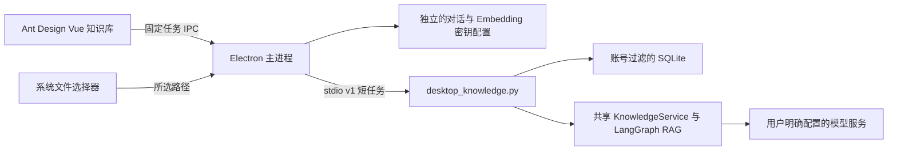

# 桌面知识库（Agent 0.3）

桌面“找资料助手”右上角进入“我的知识库”。Ant Design Vue 提供文档列表、导入、删除、关键词/混合检索、引用问答与索引原文抽屉。沿用工作区主题色、深浅色和字体；窄窗口切换为上下布局。

## 使用

1. 登录后进入知识库。无需模型 Key 即可使用本地关键词索引。
2. 点击“导入文档”，确认后在系统选择器中选择 PDF、EPUB、UTF-8 TXT 或 Markdown。默认仅在本机提取和索引；不会自动读取平台全部文件。
3. 输入问题，按需筛选最多50篇文档，点击“仅检索”。默认检索全部当前账号文档，最多返回6个片段。
4. 若需解释，配置自己的兼容 Chat Completions 模型，再点击“检索并回答”。问题与片段会发送给该服务。引用通过校验后可点击查看索引原文，连续引用文字会高亮。
5. 混合检索需另行配置兼容 Embeddings 的地址、模型和自己的 Key。导入时明确勾选建立向量索引，之后选择混合检索。文档文字或问题会发送至向量服务，并按服务商规则计费。仅有关键词索引的文档需删除后以向量方式重新导入；更换向量模型/地址或维度后也需重新导入，避免混用索引。
6. 删除仅移除当前账号知识库的文档与索引，保留原始文件。操作停止后如不确定导入/删除是否完成，刷新列表核对。

## 结构与边界

不依赖 FastAPI 常驻进程，不开放本机 HTTP 端口，也不自动启动 MCP。三种入口共用 `knowledge_store.py`、`KnowledgeService`、`run_rag`；HTTP 的令牌认证与模型地址白名单、MCP 的宿主身份配置仍独立。桌面使用自己的数据库和身份，不自动连接独立部署的知识库。

主进程固定数据库为 `userData/knowledge/documents.sqlite3`，身份由平台地址与用户 ID 的 SHA256 得到。渲染进程只能提交固定的 `list/import/delete/search/ask/read` 动作，不能指定数据库路径、所有者或本地文件路径。导入路径只来自主进程的系统选择器，不进入模型或图状态；模型没有文件读取/导入/删除工具。所有者过滤先于检索排序。

对话模型与 Embedding 使用不同的配置槽和密钥，可分别移除。默认仅本次账号会话使用；可选 OS 加密保存。Key 经 stdin 传递，不作为进程参数或环境变量，不返回给界面，不存入 SQLite。退出、换账号或窗口销毁会清除两类会话凭据并取消工作；返回目录助手只取消本面板请求，保留当前账号模型设置。渲染层用版本标记丢弃迟到结果。

文档正文与向量在 SQLite 明文保存，删除是逻辑删除，不保证磁盘取证不可恢复。界面显示导入时保存的文字片段，不重新打开原文件；PDF 引用为物理页码，EPUB 为书脊分节序号，文本为每50000字符导入分段序号。原始路径不持久化，因此没有点击引用自动打开源文件的功能。

限制沿用共享核心：单文件16 MiB，最多1000个位置、200万字符、3000个分块；每个位置最多10万字符。每账号200篇、10000个片段、1000万字符。位置内按1200字符分块，重叠200字符；检索使用中英文 BM25，可选精确余弦和 RRF k=60。问答最多两次模型调用，修正使用相同证据，空检索不调用生成模型。主进程与 worker 均有180秒总处理上限。没有 OCR、ANN、reranker、token 流式输出或持久化任务恢复。

Python 首次提取会载入 `pypdf`，已加入核心依赖与冻结程序。开发端运行 `npm run agent:setup` 更新环境；打包前运行 `npm run agent:build`。用户安装完整打包客户端后无需自行安装 Python 或启动后端服务。

## 验证入口

在 `PezMax-Desktop` 执行 `npm run test:system`、`npm run build`；在 `PezMax-Agent` 执行 `.venv\Scripts\python -m unittest discover -s tests -v`，然后构建冻结程序，再执行桌面的 `npm run test:agent-integration`。

知识库集成测试通过真正的源码/冻结 stdio worker 导入明确标注的合成软件 PDF、EPUB、Markdown，校验位置、检索、引用纠正、两类 BYOK 分离、混合索引、账号隔离、取消与删除。模型与向量是本机脚本服务，验证协议和机制，不代表真实模型效果。未使用用户现有密钥和私人文档。
