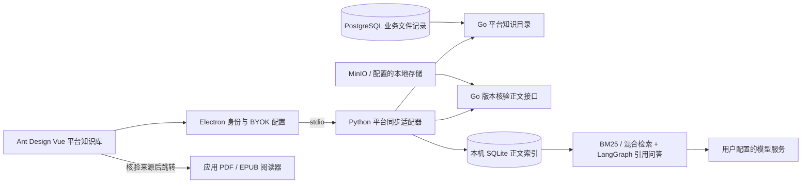

# 平台资料 RAG（Agent 0.4）

## 用户体验

“我的知识库”默认进入“平台资料与电子书”，自动从应用已有资源建立本机关键词索引。用户无需下载后重新导入，也无需配置模型 Key 即可搜索正文；需要解释时再使用自己的对话模型 Key 生成带引用的回答。文档选择框可按标题、学科、学校、年份搜索筛选。

点击引用先查看索引原文；点击“打开应用内原文”会重新检查平台记录，在原有阅读器打开文件。PDF 定位物理页码，EPUB 定位书脊章节；TXT/Markdown 打开文档，不承诺精确滚动到段落。原来已打开的文件会刷新为引用对应的版本。“个人本机文档”保留独立导入流程，与平台索引互不混检。

## 结构

业务数据库和文件存储是来源，SQLite 是可重建的检索缓存。平台索引按账号隔离，路径是原知识库数据库路径后追加 `.platform`；个人导入文档仍使用原数据库。桌面继续使用短任务 worker，无需常驻 FastAPI/MCP；独立服务与 MCP 不会自动获得平台会话或业务数据库权限。

## 接口与生命周期

| Go 接口 | 行为 |
| --- | --- |
| `GET /datum/knowledge/manifest` | 需有效应用会话；从 `ptmj_file`、`ptmj_ebook` 联合查询已上架、未删除且格式/大小受支持的资源，返回文件 ID、分类与版本，不返回存储地址 |
| `GET /datum/knowledge/source?kind=…&id=…&revision=…` | 需有效会话；重新核验单个来源及版本 |
| `GET /datum/knowledge/content?kind=…&id=…&revision=…` | 仅读取当前公开上架资源；与现有预览一致可匿名读取，核验版本后通过服务端配置的存储读正文；不产生下载记录 |

版本摘要覆盖类型、业务 ID、名称、格式、分类、学校、年份、存储地址、大小与业务更新时间。用户上传通常生成新的对象键；后台绕过应用、直接覆盖相同对象且不更新记录不在版本检测保障内。

同步以 `kind:id` 派生稳定的索引文档 ID，同文不同业务记录仍保留独立来源。未改变的记录复用索引；变化后移除旧索引并重新解析；单文档新正文和片段事务写入。解析失败、扫描件或容量不足会记录失败项目，可重试，不能据此认定资料没有相关内容。停止/超时可能留下已完成的部分同步，再次同步可复用已完成记录。

每次平台列表、检索、问答、原文查看、引用跳转均先获取新目录，移除下架、删除或版本失效缓存；问答生成结束后再核验一次。平台不可达时返回错误，不将缓存当作仍获准的数据返回。索引原文与跳转额外核验单个来源。离开知识库后已打开的阅读器沿用既有预览行为，不能撤回用户已经看到或保存的公开资料。

Worker 只访问配置平台的固定 API，既不跟随目录中的 URL，也不跟随 HTTP 重定向。模型不控制平台地址、存储路径、所有者或同步操作。会话令牌仅用于平台请求，不进入模型/向量请求、图状态或 SQLite；进程间通过 stdin 传递，输出脱敏。

## 范围、费用和限制

- 本阶段是客户端自动同步的有界平台 RAG，尚非服务器全站共享向量索引。支持 PDF、EPUB、TXT、Markdown；目录选取最近更新的最多200篇受支持资料。接口和界面展示总量、范围及未覆盖提示；不会宣称搜索了全站所有文件。
- 每文件不超过16 MiB、1000个位置、200万字符、3000片段；每账号仍限制10000片段、1000万字符。因此长文档可能先触及总片段/字符限制；同步失败会显示。没有 OCR，扫描 PDF、复杂公式和版面提取质量仍有限。
- 初次进入自动同步仅建立关键词索引，不调用计费模型。向量同步必须明确勾选；使用用户独立配置的 Embedding Key，将正文发送给该服务，可能计费。问答仅发送问题与检索片段到对话模型。
- 关键词同步保留已有向量。显式向量同步可以升级原关键词索引或更换索引配置；新向量成功生成后事务替换。不同模型/维度的向量不混算；配置不匹配时要求同步或筛选。
- 平台缓存的正文与可选向量在本机明文保存；逻辑删除不保证物理擦除。真实资料的检索质量与模型回答质量需另行授权评估。

## 设计记录与验证入口

界面采用现有工作区的 Extension 模式：保留名称、返回路径、Ant Design Vue 控件、深浅主题和阅读器，增加来源选择、同步、覆盖提示和原文跳转。沿用 `AssistantTheme.vue` 的 `--ide-accent`、系统字体、10px 控件圆角及既有间距/断点，不引入新色板、图片或装饰动画。变化/动效/密度/素材依赖/品牌保真拨盘为 2/2/7/1/10，对应稳定双栏、状态反馈、紧凑资料列表和现有主题复用。

统一验证入口：Go `go test ./internal/kadmin ./internal/kadmin/modules/datum`；Python 原 tests 与 service_tests；桌面 `npm run test:system`、`npm run build`、`npm run agent:build`、`npm run test:agent-integration`。新增平台集成使用明确标注的合成软件 PDF、脚本模型与向量服务，覆盖真实源码/冻结 worker；不读取实际用户资料或已保存 Key。

本次执行结果与证据边界见[验证记录](./platform-knowledge-verification.md)。
