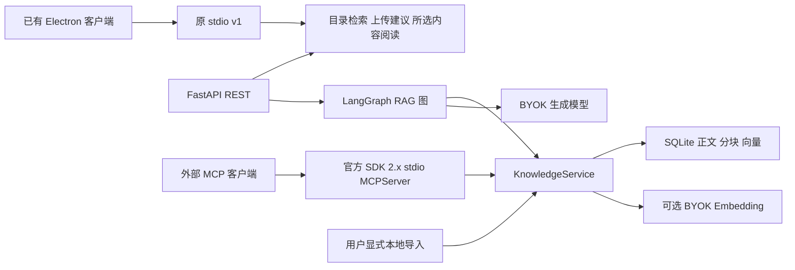

# FastAPI MCP 与文档 RAG 使用说明

## 架构与入口

Python 模块提供三个独立入口，共享应用层与知识库：



FastAPI 是长驻、带认证的可选服务。MCP 是由宿主启动的只读 stdio 服务，不需要 FastAPI 先运行，也没有在 HTTP 上提供 `/mcp`。现有桌面 UI 仍调用原 stdio，没有知识库管理界面。外部 Agent 可以通过 MCP 自行选择检索与读取工具；服务内的知识库问答是显式 LangGraph 工作流，没有宣称多智能体或自主规划。

## 安装与启动

从 `PezMax-Agent` 目录执行。服务使用独立虚拟环境，避免改变桌面冻结构建环境：

```powershell
python -m venv .venv-service
.venv-service\Scripts\python -m pip install -r service-requirements.lock -e ".[service]"

$serviceToken = .venv-service\Scripts\python -c "import secrets; print(secrets.token_urlsafe(32))"
$env:PEZMAX_AGENT_ACCESS_TOKENS = @{local = $serviceToken} | ConvertTo-Json -Compress
$env:PEZMAX_AGENT_DEMO_TOKEN = $serviceToken
$env:PEZMAX_AGENT_DB = Join-Path (Get-Location) 'data\knowledge.sqlite3'
$env:PEZMAX_AGENT_PROVIDER_URLS = '["https://你的模型服务/v1"]'
# 只有调用原目录检索任务时需要：
# $env:PEZMAX_AGENT_CATALOG_URL = 'http://127.0.0.1:9033'
.venv-service\Scripts\python -m pezmax_agent.server
```

API 默认监听 `127.0.0.1:9044`，健康检查 `/health`，OpenAPI `/docs`。在 Swagger 的 Authorize 中输入生成的服务令牌。不要把这个令牌当作模型 Key；令牌决定本地知识库身份，BYOK Key 用于模型服务。不要提交实际令牌、Key 或数据库。访问令牌环境变量是部署者配置的 `{"稳定身份":"随机访问令牌"}`；令牌轮换时保留身份即可沿用索引。

模型和 embedding 的 `baseUrl` 必须精确匹配部署白名单，包括路径和端口；Key 每次请求提供。白名单不接受调用者的任意目标。HTTP 客户端不继承机器代理环境变量，且不跟随重定向。需要代理时可由部署者将受信网关地址加入白名单。目录地址由部署配置决定，请求只能传 `catalogToken`。

服务默认单个进程最多4个活跃认证请求，超额返回429；请求体最多8 MiB，即使分块传输也检查实际大小；正文读取10秒、处理180秒。客户端断开会取消待完成的上游请求；已送达服务商的请求仍可能计费，已经启动的短 SQLite 事务可能完成，可用稳定文档ID查询确认。没有持久任务队列或跨重启恢复。非回环部署需要由部署者提供 HTTPS、网络边界与持久卷，并评估吞吐；当前验证不代表云生产容量。API 不提供 token 流式输出。

## 文档导入与真实检索

直接本地导入支持 PDF、EPUB、UTF-8 TXT/Markdown。使用与 API 访问令牌对应的稳定身份：

```powershell
.venv-service\Scripts\python -m pezmax_agent.knowledge_cli --owner local import examples/queue-notes.md
.venv-service\Scripts\python -m pezmax_agent.knowledge_cli --owner local search "背压如何限制任务增长"
```

也可以在本机提取后，通过 API 导入并查询，不要求客户端访问服务数据库：

```powershell
.venv-service\Scripts\python examples/service_demo.py examples/queue-notes.md "背压如何限制任务增长"
```

示例从当前进程环境读取 `PEZMAX_AGENT_DEMO_TOKEN`，本机提取文档后发送带位置的文字。PDF/EPUB 不在 API 服务进程中解析；API 只接受受限 JSON 文本片段，不接收任意文件路径或下载 URL。API 的 `POST /v1/knowledge/documents` 输入：

```json
{
  "document": {
    "title": "合成软件资料",
    "format": "pdf",
    "sections": [{"location": 3, "text": "有界队列通过背压限制生产者速度。"}]
  }
}
```

`format` 为 `pdf`、`epub` 或 `text`；`location` 分别表示 PDF 物理页码、EPUB 书脊分节或文本导入分段。CLI PDF/EPUB 提取保留这些位置，不执行 EPUB 脚本、不解压到磁盘。二进制导入上限16 MiB；最多1000个位置、200万字符；每段最多10万字符。扫描件没有文字时拒绝索引，不支持OCR。请只导入可信、获准使用的文件；本地解析器并非隔离渲染沙箱。

每段按1200字符、200字符重叠分块，不跨物理位置。按规范化内容和格式计算稳定文档ID，已存在且配置一致的文档再次导入时不调用 embedding；并发首次导入仍可能重复计算，数据库最终只保存一份。不同索引配置必须显式删除后重建，不暗中覆盖。每身份最多200份文档、10000个片段、1000万字符，单文档最多3000片段。

SQLite 中的正文和向量以明文存储在部署者指定路径；隔离是应用层身份过滤，不是数据库加密，也不阻止拥有该文件系统权限的人读取。删除接口逻辑删除文档及关联片段，不承诺擦除备份或存储介质残留。默认 `data/` 已被 Git 忽略。

## 向量索引与混合 RAG

默认 `keyword` 使用英文词项、中文单字和重叠双字的 BM25，无 embedding 费用。`hybrid` 需要文档预先建立向量及每次请求提供同一配置，使用精确余弦检索和 BM25，再用 `RRF(k=60)` 融合两个候选列表。最多30个候选/分支、最多6个返回片段。SQLite 保存向量，当前使用有界全量扫描，适用于本地小知识库，不是近似最近邻向量数据库。

向量化以每批最多16个片段请求兼容 `/embeddings` 的服务；会把正文发给该服务并产生费用。先在当前终端手动设置 `PEZMAX_AGENT_EMBEDDING_BASE_URL`、`PEZMAX_AGENT_EMBEDDING_MODEL`、`PEZMAX_AGENT_EMBEDDING_KEY`，再显式选择：

```powershell
.venv-service\Scripts\python -m pezmax_agent.knowledge_cli --owner local --embedding import examples/queue-notes.md
.venv-service\Scripts\python -m pezmax_agent.knowledge_cli --owner local --embedding search "如何避免生产任务无限累积"
```

若已在关键词模式导入同一文档，需要先使用显式删除命令或 API 删除后重建，避免不知情的二次计费。模型指纹使用接口地址和模型ID，另核验维度、批次索引、向量数量和有限非零数值。选中的向量文档配置混杂时报错；不会悄悄改用关键词模式。没有向量的其他文档在混合模式中仅参与 BM25，响应 `vectorChunks` 披露向量覆盖数。模型服务在相同ID背后更换权重无法自动识别，需要用户重建。

知识库带引用问答入口 `POST /v1/knowledge/ask`：

```json
{
  "query": {"question": "背压的作用是什么", "mode": "keyword", "limit": 6, "documentIds": []},
  "provider": {"baseUrl": "https://你的模型服务/v1", "model": "你的生成模型", "apiKey": "仅在本次请求提供"}
}
```

混合模式另传同结构的 `embedding` 配置，`query.mode` 使用 `hybrid`。RAG 图为 `retrieve → answer → validate → optional repair → validate`，最多2次生成调用，纠正不再次检索或重放错误答案。检索结果为空时不调用生成模型。每条回答必须同时通过文档ID、片段ID、位置和连续原文校验；部分有效结果保留，显式拒答不重试。返回检索片段、覆盖说明和不含正文的数值诊断。引文存在仍不等于语义推论正确。

`examples/service_demo.py --ask` 使用 `PEZMAX_AGENT_GENERATION_BASE_URL`、`PEZMAX_AGENT_GENERATION_MODEL`、`PEZMAX_AGENT_GENERATION_KEY` 生成回答；`--embedding` 另开启向量。也可以直接使用 API 提供每次请求的设置。真实 Key 不应放在命令行、MCP 工具参数或提交文件中。

## API 路由

| 路由 | 用途 |
| --- | --- |
| `GET /health` | 无凭据健康检查 |
| `GET /v1/knowledge/documents` | 当前身份文档列表 |
| `POST /v1/knowledge/documents` | 显式导入带位置的文字，可选向量化 |
| `DELETE /v1/knowledge/documents/{id}` | 当前身份文档与分块删除 |
| `GET /v1/knowledge/documents/{id}/chunks/{chunkId}` | 读取真实原文证据 |
| `POST /v1/knowledge/search` | `query` 与可选 `embedding`，仅检索 |
| `POST /v1/knowledge/ask` | 检索并生成经过引用核验的回答 |
| `POST /v1/run` | 复用原 search/upload/reading 任务或 `test:true` 连接测试 |

所有 `/v1/` 路由均要求 `Authorization: Bearer 服务令牌`。不接受请求体里的 owner，身份在排序前约束所有候选。请求校验错误不回显输入，模型错误不透传服务商响应。API 不保存 BYOK Key；LangSmith 与 OpenTelemetry SDK 导出均关闭。应用不会配置正文日志；部署代理与客户端自行记录请求的行为需要另外管理。

## MCP 接入

使用[官方 MCP Python SDK 2.x](https://py.sdk.modelcontextprotocol.io/) 的 `MCPServer`（锁定 `mcp==2.3.0`），通过类型化工具与资源暴露真实知识库能力，不自行拼装 JSON-RPC。

在 MCP 宿主中配置 stdio 启动命令：

```json
{
  "mcpServers": {
    "pezmax-knowledge": {
      "command": "D:/你的项目/PezMax-Agent/.venv-service/Scripts/python.exe",
      "args": ["-m", "pezmax_agent.mcp_server"],
      "env": {
        "PEZMAX_AGENT_DB": "D:/你的项目/PezMax-Agent/data/knowledge.sqlite3",
        "PEZMAX_AGENT_MCP_OWNER": "local"
      }
    }
  }
}
```

该身份由宿主配置固定，工具参数不能改变身份。stdio 没有网络令牌认证，授权来自宿主对进程及数据库文件的访问；不要将该进程透明转发为未认证网络端口。

工具：`list_documents`、`search_documents`、`read_document_chunk`，均标注只读。资源：`pezmax://documents` 和 `pezmax://documents/{documentId}/chunks/{chunkId}`。模型看不到写操作、数据库路径或模型 Key 参数。默认关键词检索；宿主配置 embedding 环境变量且工具明确请求 `mode:"hybrid"` 时，才把问题发给该服务。MCP 不负责替外部宿主验证最终回答，外部宿主可以读取原文自行引用；FastAPI `/ask` 才执行本模块的生成与引用核验图。

## 验证与评测

开发完成后统一执行：

```powershell
.venv-service\Scripts\python -m unittest discover -s service_tests -v
.venv\Scripts\python -m unittest discover -s tests -v
.venv-service\Scripts\python -m pezmax_agent.retrieval_evaluation --output evals/results/retrieval-local.json
.venv\Scripts\python -m pezmax_agent.evaluation --output evals/results/reading-local.json
```

`evals/retrieval-cases.json` 是小型合成软件/数学资料集，有固定相关文档标签。默认测真实 BM25 检索的文档级 Recall@3 / MRR@3；`--embedding` 才向用户配置的真实 embedding 服务发送合成资料，并在同一索引上增加混合检索对照。输出包含数据集哈希和模型指纹，不含 Key。样本很小，不能外推真实用户效果；没有调用真实 embedding 时不报告混合检索效果提升。单元测试的向量来自脚本，只证明余弦/RRF及契约行为。

官方 SDK 客户端验证实际 stdio 子进程握手、工具与资源；ASGI 测试验证认证、用户隔离、导入/删除/问答、白名单、容量及超时。既有桌面 stdio 的生产构建与源码/冻结集成仍需作为兼容性检查。

本轮实际执行结果与范围见[服务与检索验证记录](service-verification.md)。
