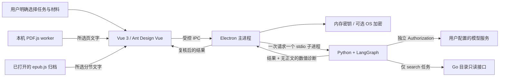
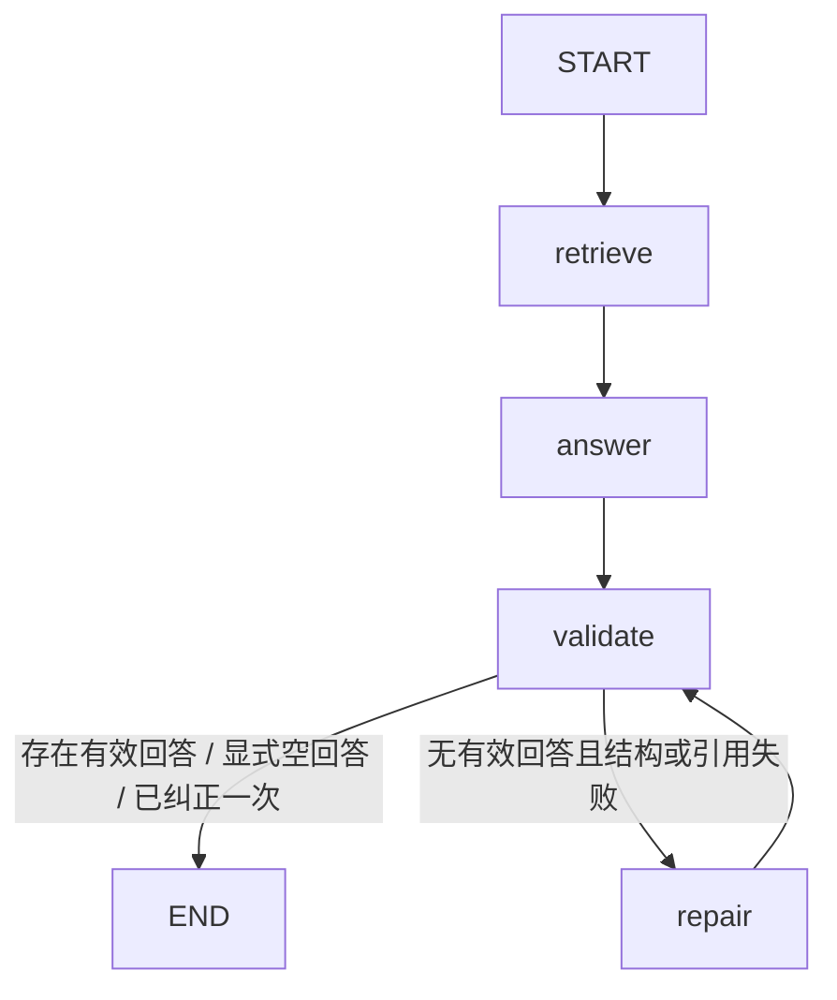

# Agent 工程架构与取舍

本阶段目标是让 PezMax 的智能助手可演示、可解释、可验证。技术选择围绕实际功能：Python LangGraph 编排、Pydantic v2 结构契约、带定位证据的阅读、受限工具执行、本机进程隔离与确定性评测。

0.2 新增独立 FastAPI、MCP SDK 2.x 和 SQLite 文档 RAG。其可行性与数据边界见[服务设计](../../PezMax-Agent/docs/service-design.md)，部署、接口和检索方式见[服务使用说明](../../PezMax-Agent/docs/service.md)。本页下述架构描述默认桌面 stdio 模式；新知识库正文会持久化，不能套用旧阅读的“只处理所选文字且不落盘”描述。

## 系统边界



- 凭据存于依赖对象，不能进入 LangGraph 状态或对话历史。模型密钥与平台令牌分开使用。
- 每轮独立子进程，无本机 HTTP 服务。取消由 Electron 中止进程；渲染层使用版本标记丢弃迟到结果，并等待上一请求释放后再重试。
- PDF/EPUB 提取在渲染进程本机执行。Python 不接收文档路径、下载 URL、完整归档或 EPUB 内部 href。
- 找资料有唯一白名单工具 `search_resources`；上传建议和阅读没有工具。实际资源卡片来自目录对象，模型文字不能构造可操作资源。

## 三种图的职责

| 图 | 决策与状态 | 调用预算 | 用户确认点 |
| --- | --- | --- | --- |
| 找资料 | `model → search → model` 条件循环；累积真实资源、检索报告和有界历史 | 最多5轮模型、8次检索 | 用户提问；卡片沿用现有打开/收藏/下载操作 |
| 上传建议 | `suggest → validate`；字段、枚举、年份和文件名依据校验 | 1次模型 | 默认不勾选字段，由用户逐项选择回填后自行提交 |
| 阅读增强 | 检索/抽样 → 回答 → 严格结构及引文核验 → 有界纠正 | 0–2次模型 | 明确选页/分节、本地提取、再发送任务 |

上传的确认回填是 UI 层的人机协作，没有使用 LangGraph `interrupt` 或持久化恢复；不应混淆这两种实现。

## 阅读条件图



1. **检索或抽样**：问答按词语匹配选择相关片段；摘要/提纲均匀抽取所选文字，保留头尾，避免把通用摘要任务当作检索关键词。最多6段×1800字符，部分覆盖明确展示。当前没有嵌入模型、向量库或全文语义检索。
2. **结构契约**：Pydantic 严格模型生成 JSON Schema，约束回答数、长度、位置与引用数；禁止额外字段，不把 `true` 或 `"2"` 转成页码。Schema 进入提示、本机验证，不依赖服务商的原生约束解码。
3. **证据核验**：位置必须属于实际发送的片段，规范化空白后的连续引用必须存在于对应片段。一条回答有任意错误引用则整体丢弃；保留其他有效回答。
4. **有界纠正**：无有效回答且校验失败时，使用同一任务、同一证据重做一次。拒绝的原始答案和第三方错误文本不重放。显式证据不足、部分有效、网络或鉴权错误不触发该路径。
5. **位置安全**：PDF 物理页码与 EPUB 书脊分节使用不同契约。主进程和渲染层再次核验，点击时根据当前文档解析位置，不接受模型 href。

这是带确定性引用校验和条件纠正的工作流，不是经过训练的 Self-RAG。引文存在仅证明引用来源，不能证明回答的推论被原文蕴含；语义质量仍需真实模型评测与人工复核。

## 可观测性与隐私

`RunMetrics` 使用单调时钟记录固定节点名、`durationMs`、成功标记，以及模型/检索/纠正/引用计数。白名单拒绝任意计数字段、字符串和负数，不保存输入、输出、图状态或异常文本。诊断随当前 stdio 结果返回，进程退出即释放；客户端阅读 UI 只显示总耗时和模型调用次数。

运行时显式关闭 LangSmith 托管追踪，没有持久化 checkpoint。这里选择的是隐私边界清晰的短任务；若以后增加跨重启恢复，需要另行设计正文与图状态的存储生命周期，不能仅添加数据库连接就宣称已支持 durable execution。

## 可复现评测

在 `PezMax-Desktop` 执行：

```powershell
npm run agent:test
npm run agent:eval -- --output evals/results/local.json
npm run test:system
npm run build
npm run agent:build
npm run test:agent-integration
```

`reading-cases.json` 的10种场景 × 2种格式 × 3种任务构成60个离线案例。真实 LangGraph 图连接脚本模型，覆盖正确引用、错位置后的纠正、伪造引文、畸形 JSON、布尔/字符串位置、额外字段、显式拒答、保留有效子项、空文字。独立 grader 检查最终结果与实际上下文，不用 LLM 自评分。

报告比较“未经验证首答”“仅验证”“验证+一次纠正”，量化行为通过数、无效结果释放数、可恢复案例数及模型调用数。脚本模型的耗时不代表真实模型延迟；案例恢复数不代表线上准确率。结果见 [验证记录](./reading-assistant-verification.md)。

## 默认桌面模式保留的限制

- 仅所选内容，未实现全文索引、OCR、向量/混合检索或 reranker。
- 模型非 token 流式；进度为节点状态事件，不宣称 token streaming。
- 桌面默认 stdio 没有多智能体、MCP、持久化会话恢复、自动上传或审核能力。独立模块另提供可选 MCP 与文档 RAG，尚未接入桌面知识库 UI。
- 兼容 Chat Completions 的 BYOK 适配器，服务商差异由用户连接测试和实际调用确认。
- 单轮预算限制调用次数，不能保证服务商账单上限。需要真实模型、计价和使用量统计才能评价成本。

这些限制为后续实验提供基线。只有任务规模、可测收益和数据授权支持时，再增加向量检索、持久化任务或其他协议。
