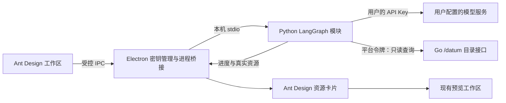

# 智能助手（BYOK）

桌面端的“找资料助手”将自然语言需求转换为平台目录检索，再以真实资源卡片连接已有的预览、收藏和下载流程。智能体使用独立的 **Python + LangGraph** 模块 `PezMax-Agent`；界面使用 Ant Design Vue 4，适配工作区的主题色和深浅色模式，首次打开时按需加载。

## 使用方式

1. 登录桌面客户端，在左侧活动栏点击机器人图标。
2. 打开“模型设置”，填写服务商的**接口基础地址、模型 ID 和自己的 API Key**。
3. 点击“保存并测试”。连接测试会产生一次模型调用，成功后即可提问。
4. 描述学科、学校、年份或资源类型，例如“帮我找示例大学 2022 到 2024 年高等数学的期末试卷”。可继续追问“只看 2023 年的”。
5. 点击资源卡片里的“打开资料 / 电子书 / 书签”，进入现有阅读工作区；再点击机器人图标可继续当前对话。

支持停止、重试本轮和新建对话。中文输入法选词时按回车不会发送；普通回车发送，Shift + Enter 换行。对话仅保留在内存，退出登录或重启后清空。

## 上传命名与分类建议

在“贡献文件”选择文件后，表单顶部会出现 Ant Design 上传建议组件。复用当前账号的模型设置，也可直接在此配置自己的 API Key。点击“生成上传建议”后才发起模型调用；生成后默认不勾选任何字段。每项展示表单现值、建议值和文件名原文依据，勾选后点击“应用已选建议”回填，再检查并自行提交上传。

- 单份资料：建议资源名称、学校、学科、年份和资料类型；无法确定的字段不返回。
- 电子书：建议书名、学科和电子书类型；不推测作者或出版社。
- 文件夹：最多20个文件，仅建议所有文件名均支持的共同学校、学科、年份和资料类型，保留各文件原名；超出20个时提示分组，不偷偷抽样。混合年份或跨学年不建议年份。
- 仅发送上传种类、是否为文件夹和文件名列表，不发送本地路径、正文、表单现值、搜索对话或平台登录令牌。模型不会执行上传、读取正文或重命名本地文件。
- 生成后手动改过的字段会在应用时跳过并提示；切换文件、开始上传、切换账号和离开组件会清除建议、取消本组件请求并忽略迟到结果。模型错误、信息不足和停止生成均可重试。

文件名依据只是建议的来源，不能证明分类必然正确，提交前仍需用户检查。

## 阅读增强：问答、摘要与提纲

打开 PDF 资料、PDF/EPUB 电子书，或拖入本地 PDF/EPUB 后，点击预览区顶部的“阅读助手”。使用与其他助手共用的模型设置和用户自己的 API Key。

1. 选择“阅读问答”“内容摘要”或“内容提纲”。摘要和提纲使用固定任务，不需要输入问题，提纲最多5项。
2. PDF：选择连续1–10个物理页码（从1开始），点击“本地提取所选页”。EPUB：先“读取分节目录（本机）”，选择1–5节，再点击“本地提取所选分节”。分节按书脊顺序编号，可能与书内章节号不同，不是页码。可查看提取文字；上述操作均不调用模型。
3. 点击“发送问题”或“生成”。只向配置的服务发送本次任务和所选内容的相关片段，无对话历史。通常1次调用；结构或引用校验失败且没有有效回答时最多额外纠正1次。纠正不改变片段、不读取其他内容，按服务商规则计费。
4. 回答附连续原文，点击位置跳回当前 PDF 物理页或当前 EPUB 分节。逐项复核引用；两次都失败则提示证据不足。显式空回答不重试，有有效回答时保留有效部分、丢弃无效项。界面显示实际参考位置、部分覆盖提示、本轮模型调用数及含本机处理的耗时。原文核对不能保证解释正确，请结合上下文阅读。

不自动读取当前页或整本书。单个 PDF 最大50MB、最多10000页，每页最多20000字符。EPUB 复用已载入的压缩包，每节解压标记最多2MiB、可提取文字最多40000字符；最多10000个书脊分节。两种格式所选总文字均不超过80000字符。本机问答按词语匹配挑选最多6段、每段1800字符；摘要/提纲均匀抽取最多6段，因此长内容只概括抽样片段，不能代表完整文档。

扫描件不支持 OCR。EPUB 使用不挂载到页面的 XML DOM 解析，过滤脚本、隐藏标记和资源属性，不加载分节钩子或执行脚本；不进行 CSS 排版，样式表隐藏内容和复杂布局可能与可见页面不同，发送前可检查文字。加密/损坏文件或超限文字明确报错。复杂公式和多栏顺序可能提取不完整，不应推测缺失内容。

下载地址仅用于渲染进程本地取文档，不进入模型或 Python 请求。PDF.js worker 随客户端打包，按需加载；EPUB 复用现有 epub.js 的归档，提取不销毁共享阅读器。提取最长45秒。文字、提问和结果只留在内存，切换文件、账号、页码/分节或关闭助手会取消请求并清理内容；切换阅读方式清理结果、保留已提取文字；停止后可以重试。

Go 静态 `/uploads/*.pdf` 的公开 GET/HEAD 响应允许无凭据跨域读取，以支持桌面端的本地取文档。部署时需同步升级该入口；使用外部对象存储/CDN 时也应按服务商方式配置公开 PDF 的读取 CORS。客户端不关闭网页安全检查，不通过智能体代理下载文件。

## 模型服务要求

- 兼容 `POST {baseUrl}/chat/completions`、Bearer API Key、`messages`、`tools`、`tool_choice` 和非流式响应。
- 模型需支持 Function Calling，工具调用返回 `message.tool_calls`。连接测试只确认接口可响应；完整找资料流程仍依赖模型正确调用工具。
- 基础地址示例：`https://服务商域名/v1`，最终调用 `/v1/chat/completions`；填写完整 `/chat/completions` 地址时会自动归一化。
- 远程地址必须使用 HTTPS。本机 `localhost`、`127.0.0.1`、`[::1]` 可使用 HTTP，但仍需填写密钥。不能在地址中夹带账号、密码、查询参数或片段。
- 配置属于当前服务端地址与当前平台用户。更换模型服务地址时需重新输入对应的 Key；更换地址或模型会清空之前的对话上下文。

项目不内置共享密钥，不要求在服务端部署模型 SDK，也不替用户选择收费模型。模型费用由用户与所选服务商结算。

## 数据和密钥

| 数据 | 处理方式 |
| --- | --- |
| API Key | 默认存 Electron 主进程内存，执行时经 stdin 交给本机 Python 子进程；不进入 PezMax Go 后端、不返回给渲染界面、不写入 localStorage。仅通过 Authorization 发送至用户配置的模型服务 |
| 平台登录令牌 | 仅交给本机模块请求平台目录；与模型 Key 分开使用，不进入模型请求、图状态或对话历史 |
| 可选“加密保存在本机” | 使用 Electron safeStorage 交给操作系统加密，密文存于应用 userData 下的 `ptmj-assistant.json`；不支持安全加密的系统不能启用 |
| 接口地址、模型 ID | 保存在同一本机配置文件，按服务端地址和用户隔离 |
| 提问与近期对话 | 发送至用户所选模型服务；应用不落盘保存对话 |
| 检索结果 | 只向模型提供名称、学科、学校、年份、作者、出版社、书签描述等受限目录元数据；不发送文件 URL、原始业务对象或平台登录令牌 |
| PDF/EPUB 所选文字 | 用户明确提取后在本机解析；点击发送或生成才将任务和相关片段发给所选模型服务；不持久化文字或回答 |
| 运行诊断 | 仅在内存中记录固定节点名、耗时、成功标记、调用数与校验计数，不收集正文、问题、密钥或异常原文，不接入托管追踪 |
| 上传文件名 | 点击生成上传建议时发送给用户所选模型；不包含本地目录路径，生成建议时不请求 Go 后端，也不持久化建议 |

注销、切换账号、页面完整重载、窗口销毁和渲染进程退出都会释放内存中的密钥并取消请求。已主动选择加密保存的 Key 保留密文，下次登录同一账号时可恢复；“移除密钥”同时移除会话密钥和该账号的本机密文。

## 架构和约束



- `PezMax-Agent/src/pezmax_agent/graph.py` 使用 LangGraph `StateGraph`，包含 `model → search → model` 条件循环与 `finalize` 收尾节点。模型适配、工具契约、目录访问、状态图、进程入口分别维护，不再由 JS 手写智能体循环。
- `PezMax-Agent/src/pezmax_agent/upload.py` 使用独立 `suggest → validate` 状态图，一次模型调用生成结构化建议并校验；`task:"upload"` 经现有 stdio 协议路由，不构造目录客户端、不携带平台令牌、不提供工具。Electron 与渲染层也会复核字段、枚举及依据，回填只通过用户明确选择触发。
- `PezMax-Agent/src/pezmax_agent/reading.py` 使用独立状态图：本机文字片段筛选、模型回答、Pydantic 严格结构与原文核验，条件边最多纠正一次。`task:"reading"` 无目录、平台令牌或工具；Electron 与渲染层复核引用，位置点击只导航当前文档。JSON Schema 通过提示传给模型、由本机严格验证，不要求服务商原生约束解码。
- Electron 仅负责配置加密、受控 IPC、子进程启动和取消；Vue 仅负责会话展示、进度订阅和预览跳转。每轮启动一个独立进程，结束后退出，不开放本机 HTTP 端口。
- 模型只能请求白名单工具 `search_resources`，工具参数和真实结果在 Python 模块复核；不支持任意 HTTP、脚本或写操作。平台目录地址由客户端构建配置确定，模型不能改变目标地址。
- 已上架的资料、电子书和书签沿用现有接口的可见性规则；助手不携带所有者筛选参数获取待审核内容。
- 每轮最多 5 次模型请求、8 次搜索。每类搜索最多检查 3 页（150 条）并展示 5 项，结果去重；界面和模型均能获知截断、跳过和检索失败。
- 资料支持关键词、学科、学校、类型、年份范围。电子书和书签没有学校、年份或试卷类型字段，不能伪装成满足这些条件的结果。
- 后端 `/datum/file/list` 增加可选 `yearFrom` / `yearTo`（1900–2100，含边界），在计数和分页之前过滤。升级客户端时应同步更新 Go 服务；旧服务上的客户端仍会做年份复核，但可能只能拿到部分候选。
- 每轮处理总时限 180 秒；单次模型请求 60 秒、响应体限制 512 KiB，目录请求 10 秒、响应体限制 2 MiB；禁用重定向。会话历史和参数长度均有限制。上述限制不是服务商费用上限。
- 模型文字按纯文本显示；可打开的卡片全部来自真实查询对象。失败时保留已找到的卡片，可停止后重试。
- IPC 仅允许应用主窗口的可信主文档调用，内嵌预览页面不能访问助手服务；密钥不拼入 URL，也不回显服务商原始报错。
- 不配置持久化图检查点或托管追踪，运行时明确关闭 LangSmith 追踪，避免继承开发机的追踪设置。

普通资源树搜索也同步支持了文件名：匹配文件时保留学校、学科等父级路径；匹配文件夹时保留其子树，清空搜索恢复原树。

## 开发、打包与验证

开发智能体需要 Python 3.11 或以上；安装版已携带 Python 运行时，普通用户无需另外安装。详细模块说明见仓库中的 `PezMax-Agent/README.md`。

在 `PezMax-Desktop` 目录执行：

```powershell
npm ci
npm run agent:setup
npm run agent:check
npm run agent:test
npm run agent:eval
npm run test:system
npm run build
npm run agent:build
npm run test:agent-integration
```

`agent:setup` 创建相邻 `PezMax-Agent/.venv` 并安装锁定依赖。开发时默认使用该解释器，也可用绝对路径环境变量 `PEZMAX_AGENT_PYTHON` 指定已安装模块的解释器；安装版只运行随应用附带的模块。

`agent:build` 使用 PyInstaller 生成当前系统、当前架构的独立程序，先执行离线启动自检，再生成平台清单。`test:agent-integration` 同时验证源码解释器与独立程序的完整“模型 → 真实模拟目录 → 模型”链路和取消行为，无需真实 Key。

`npm run build:win` / `build:mac` / `build:linux` / `build:unpack` 会先构建模块，再将其复制到 Electron 的 `resources/agent/`。发布前的构建钩子校验平台、架构与协议版本，缺少匹配模块时停止打包。各平台需在对应系统和架构上构建；本次已验证 Windows x64。

目录地址沿用 `VITE_APP_BASE_API`（绝对 HTTP 地址）或 `VITE_APP_TARGET_URL`（开发代理目标），在主进程构建时固定。需要变更部署地址时应重新构建客户端。Python 请求使用 HTTPX 的系统/环境代理设置，与 Electron 的网络栈分开；代理问题需检查运行环境。

在 `k_admin` 目录执行：

```powershell
go test ./internal/kadmin/...
```

测试使用本地模拟边界，覆盖真实 LangGraph 图执行、密钥加密与隔离、IPC 来源、进程协议和 UTF-8 分片、超时与取消、目录映射、年份 SQL、工具次数上限、连续追问、账号切换、设置清理、输入法和预览跳转。真实服务商的连通性需由用户填写自己的 Key 后在客户端测试。

## 后续扩展

当前包含自然语言找资料、上传命名/分类建议、PDF/EPUB 所选内容的问答/摘要/提纲及引用导航。后续可考虑用户明确授权的 OCR 和全文索引；审核辅助已排除。本轮验证状态见[交付记录](./reading-assistant-verification.md)，架构和求职展示见[工程说明](./agent-engineering.md)及[项目素材](./agent-portfolio.md)。
