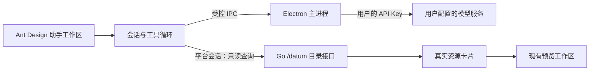

# 找资料助手（BYOK）

桌面端新增“找资料助手”，将自然语言需求转换为平台目录检索，再以真实资源卡片连接已有的预览、收藏和下载流程。界面使用 Ant Design Vue 4，适配工作区的主题色和深浅色模式，首次打开时按需加载。

## 使用方式

1. 登录桌面客户端，在左侧活动栏点击机器人图标。
2. 打开“模型设置”，填写服务商的**接口基础地址、模型 ID 和自己的 API Key**。
3. 点击“保存并测试”。连接测试会产生一次模型调用，成功后即可提问。
4. 描述学科、学校、年份或资源类型，例如“帮我找示例大学 2022 到 2024 年高等数学的期末试卷”。可继续追问“只看 2023 年的”。
5. 点击资源卡片里的“打开资料 / 电子书 / 书签”，进入现有阅读工作区；再点击机器人图标可继续当前对话。

支持停止、重试本轮和新建对话。中文输入法选词时按回车不会发送；普通回车发送，Shift + Enter 换行。对话仅保留在内存，退出登录或重启后清空。

## 模型服务要求

- 兼容 `POST {baseUrl}/chat/completions`、Bearer API Key、`messages`、`tools`、`tool_choice` 和非流式响应。
- 模型需支持 Function Calling，工具调用返回 `message.tool_calls`。连接测试只确认接口可响应；完整找资料流程仍依赖模型正确调用工具。
- 基础地址示例：`https://服务商域名/v1`，最终调用 `/v1/chat/completions`；填写完整 `/chat/completions` 地址时会自动归一化。
- 远程地址必须使用 HTTPS。本机 `localhost`、`127.0.0.1`、`[::1]` 可使用 HTTP，但仍需填写密钥。不能在地址中夹带账号、密码、查询参数或片段。
- 配置属于当前服务端地址与当前平台用户。更换模型服务地址时需重新输入对应的 Key；更换地址或模型会清空之前的对话上下文。

项目不内置共享密钥，不要求在服务端部署模型 SDK，也不替用户选择收费模型。模型费用由用户与所选服务商结算。

## 数据和密钥

| 数据 | 处理方式 |
| --- | --- |
| API Key | 默认仅存 Electron 主进程内存；不进入 PezMax Go 后端、不返回给渲染界面、不写入 localStorage。通过 Authorization 发送至用户配置的模型服务 |
| 可选“加密保存在本机” | 使用 Electron safeStorage 交给操作系统加密，密文存于应用 userData 下的 `ptmj-assistant.json`；不支持安全加密的系统不能启用 |
| 接口地址、模型 ID | 保存在同一本机配置文件，按服务端地址和用户隔离 |
| 提问与近期对话 | 发送至用户所选模型服务；应用不落盘保存对话 |
| 检索结果 | 只向模型提供名称、学科、学校、年份、作者、出版社、书签描述等受限目录元数据；不发送文件 URL、原始业务对象或平台登录令牌 |
| 文件正文 | 本版本不读取、不上传给模型 |

注销、切换账号、页面完整重载、窗口销毁和渲染进程退出都会释放内存中的密钥并取消请求。已主动选择加密保存的 Key 保留密文，下次登录同一账号时可恢复；“移除密钥”同时移除会话密钥和该账号的本机密文。

## 架构和约束



- 模型只能请求白名单工具 `search_resources`，工具实际执行仍由客户端校验；不支持任意 HTTP、脚本或写操作。
- 已上架的资料、电子书和书签沿用现有接口的可见性规则；助手不携带所有者筛选参数获取待审核内容。
- 每轮最多 5 次模型请求、8 次搜索。每类搜索最多检查 3 页（150 条）并展示 5 项，结果去重；界面和模型均能获知截断、跳过和检索失败。
- 资料支持关键词、学科、学校、类型、年份范围。电子书和书签没有学校、年份或试卷类型字段，不能伪装成满足这些条件的结果。
- 后端 `/datum/file/list` 增加可选 `yearFrom` / `yearTo`（1900–2100，含边界），在计数和分页之前过滤。升级客户端时应同步更新 Go 服务；旧服务上的客户端仍会做年份复核，但可能只能拿到部分候选。
- 单次模型请求超时 60 秒，响应体限制 512 KiB，禁用重定向；会话历史和参数长度均有限制。上述限制不是服务商费用上限。
- 模型文字按纯文本显示；可打开的卡片全部来自真实查询对象。失败时保留已找到的卡片，可停止后重试。
- IPC 仅允许应用主窗口的可信主文档调用，内嵌预览页面不能访问助手服务；密钥不拼入 URL，也不回显服务商原始报错。

普通资源树搜索也同步支持了文件名：匹配文件时保留学校、学科等父级路径；匹配文件夹时保留其子树，清空搜索恢复原树。

## 验证

在 `PezMax-Desktop` 目录执行：

```powershell
npm ci
npm run test:system
npm run build
```

在 `k_admin` 目录执行：

```powershell
go test ./internal/kadmin/...
```

测试使用本地模拟边界，覆盖密钥加密与隔离、IPC 来源、超时与取消、真实目录映射、年份 SQL、工具次数上限、连续追问、账号切换、设置清理、输入法和预览跳转。真实服务商的连通性需由用户填写自己的 Key 后在客户端测试。

## 后续扩展

当前交付范围是“自然语言找资料”。上传时的命名与分类建议、基于正文且带页码证据的阅读问答，可作为后续独立阶段；本版本尚不具备 OCR、正文问答或自动上传 / 审核能力。
